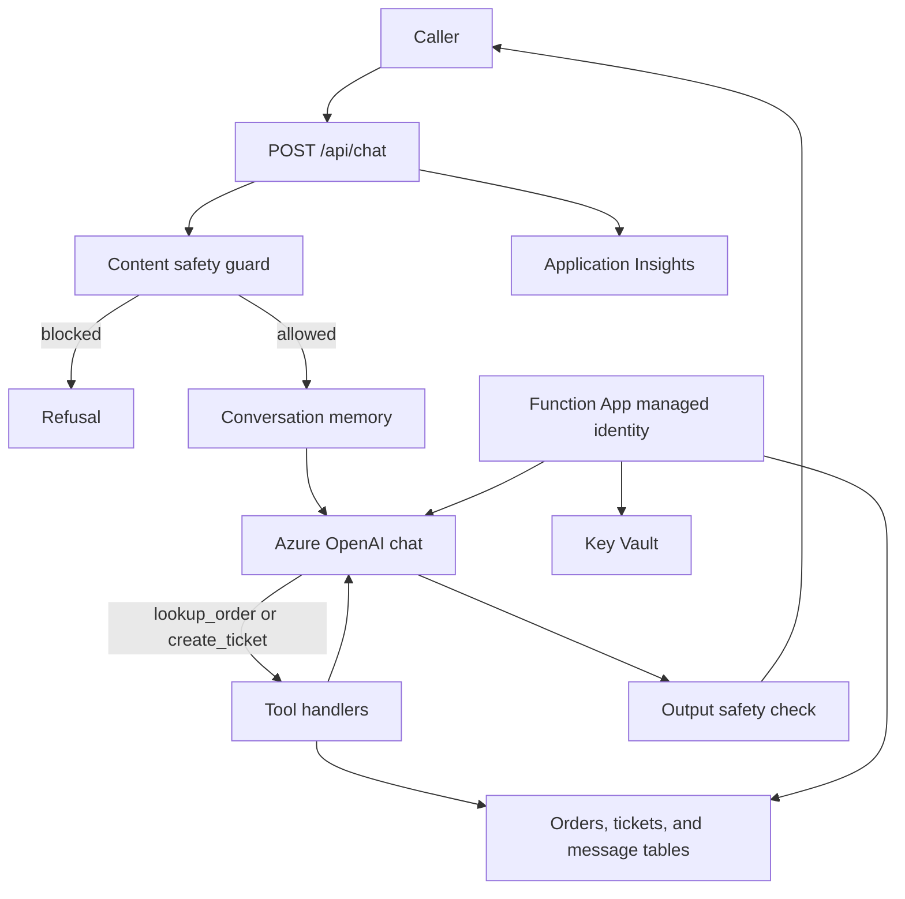

# Azure OpenAI Functions support bot

Portfolio demo of a Python Azure Functions (v2 programming model) support assistant. A caller posts a chat message. The function screens it, sends the conversation to Azure OpenAI through the `openai` SDK `AzureOpenAI` client, and can call two tools: order lookup and support-ticket creation. Orders, tickets, and conversation memory are table entities. In Azure those tables live in Storage. Secrets are read from Key Vault with the Function App's managed identity.

## Architecture



The Bicep templates describe the Function App (Linux, Python 3.11, system-assigned identity), Key Vault, Storage account and tables, Log Analytics workspace, Application Insights, and an Azure OpenAI account plus a chat deployment. CI compiles the templates. This repository does not deploy them.

## Honest note

This repository is a portfolio demo for Arpan Bom's CV. The sample orders are fictional. Tests use a scripted model client and an in-memory table store, so they need no API keys, Azurite, or other emulators. The default local process uses an offline tool router so the HTTP contract can be tried without Azure OpenAI. The in-process safety filter is a demo guardrail; a real Azure OpenAI deployment also applies the service content filters. The chat endpoint does not authenticate the customer: a caller who knows an order id can read that sample order. Latency, token usage, and Azure spend are not measured.

| Metric | Value |
| --- | --- |
| Requests per day | Not measured |
| p95 latency | Not measured |
| Token usage | Not measured |
| Azure spend | Not measured |

## Run locally

Requires Python 3.11 or newer.

```bash
python3 -m venv .venv
source .venv/bin/activate
pip install -r requirements.txt
python -m supportbot
```

The process listens on `http://127.0.0.1:8741`.

```bash
curl -s http://127.0.0.1:8741/api/health
curl -s http://127.0.0.1:8741/api/chat \
  -H 'content-type: application/json' \
  -d '{"message":"Where is order ORD-1001?"}'
```

Sample orders seeded in memory:

| Order | Item | Status |
| --- | --- | --- |
| ORD-1001 | Wireless headphones | shipped |
| ORD-1002 | Mechanical keyboard | processing |
| ORD-1003 | USB-C dock | delivered |

`POST /api/chat` accepts `message` and an optional `conversation_id` (or `conversationId`). The response includes `reply`, `blocked`, `category`, and `tool_calls`. Send the returned `conversation_id` on the next turn to continue the same memory.

`LLM_BACKEND=offline` is the default. To call Azure OpenAI instead, set:

```bash
export LLM_BACKEND=azure
export USE_MANAGED_IDENTITY=true
export AZURE_OPENAI_ENDPOINT=https://YOUR-RESOURCE.openai.azure.com/
export AZURE_OPENAI_DEPLOYMENT=gpt-4o-mini
export AZURE_OPENAI_API_VERSION=2024-10-21
export KEY_VAULT_URL=https://YOUR-VAULT.vault.azure.net/
export STORAGE_BACKEND=table
export STORAGE_ACCOUNT_URL=https://YOUR-ACCOUNT.table.core.windows.net/
```

With `USE_MANAGED_IDENTITY=true`, the process uses `DefaultAzureCredential` for Azure OpenAI (`https://cognitiveservices.azure.com/.default`) and for Table Storage. With `KEY_VAULT_URL` set, `AZURE_OPENAI_API_KEY` and `STORAGE_CONNECTION_STRING` are read from the vault secrets `azure-openai-api-key` and `storage-connection-string`. Leave `KEY_VAULT_URL` empty to read those values from the environment instead. `USE_MANAGED_IDENTITY=false` uses the API key for Azure OpenAI.

Azure Functions Core Tools can host the same handlers:

```bash
cp local.settings.json.example local.settings.json
func start
```

The Functions route is `POST /api/chat` with function-key auth. `GET /api/health` is anonymous. Core Tools are optional for this demo.

## Test

```bash
pip install -r requirements.txt -r requirements-dev.txt
pytest
```

Compile the infrastructure templates (no deployment):

```bash
bicep lint infra/main.bicep
bicep build infra/main.bicep --outfile /tmp/supportbot-main.json
```

Bicep CLI `0.48.1` matches CI. An example parameter file is `infra/main.example.bicepparam`. Deploying the template needs permission to create role assignments and to write Key Vault secrets; the identity that deploys must be allowed to do both. CI does not deploy.

## Configuration

| Setting | Role |
| --- | --- |
| `LLM_BACKEND` | `offline` or `azure` |
| `STORAGE_BACKEND` | `memory` or `table` |
| `USE_MANAGED_IDENTITY` | Azure OpenAI and Tables use managed identity when `true` |
| `KEY_VAULT_URL` | When set, mapped secrets are read from Key Vault |
| `AZURE_OPENAI_ENDPOINT` | Azure OpenAI endpoint |
| `AZURE_OPENAI_DEPLOYMENT` | Deployment name passed as the chat model |
| `AZURE_OPENAI_API_VERSION` | API version for the `AzureOpenAI` client |
| `AZURE_OPENAI_API_KEY` | Key from env, or vault secret `azure-openai-api-key` |
| `STORAGE_ACCOUNT_URL` | Table endpoint used with managed identity |
| `STORAGE_CONNECTION_STRING` | Env value, or vault secret `storage-connection-string` |
| `SEED_SAMPLE_DATA` | Inserts the fictional orders when they are missing. Defaults to on for `memory` and off for `table` |
| `HOST` / `PORT` | Local server bind address. Port defaults to `8741` |

## Layout

- `function_app.py` registers the Python v2 HTTP functions.
- `supportbot/` holds chat orchestration, tools, memory, safety checks, secret resolution, and storage.
- `infra/main.bicep` composes the Azure resources.
- `tests/` are pytest unit tests with fakes.
- `.github/workflows/ci.yml` runs pytest and Bicep lint/build.

## License

MIT. Copyright (c) 2026 Arpan Bom.
